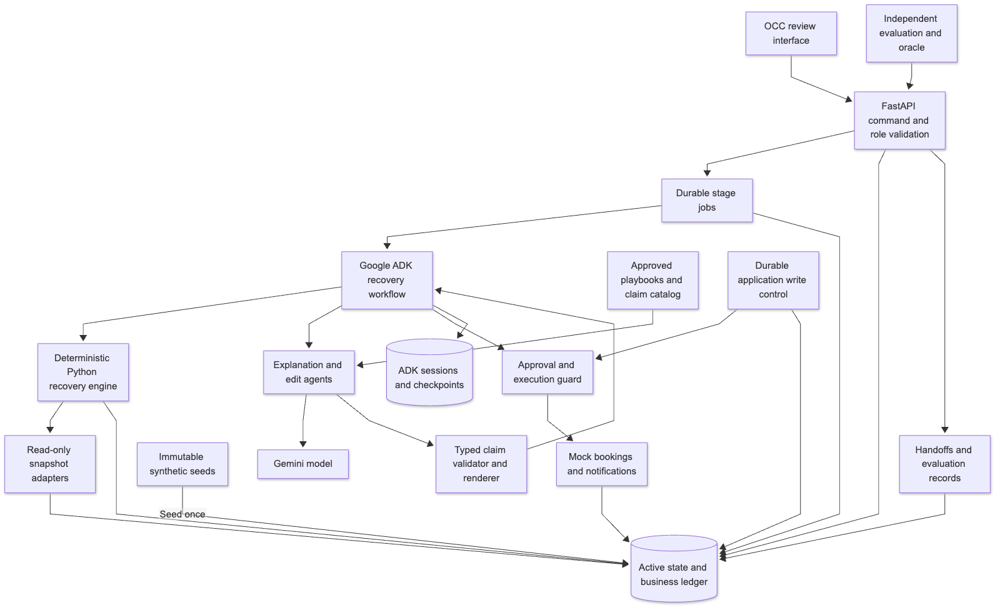
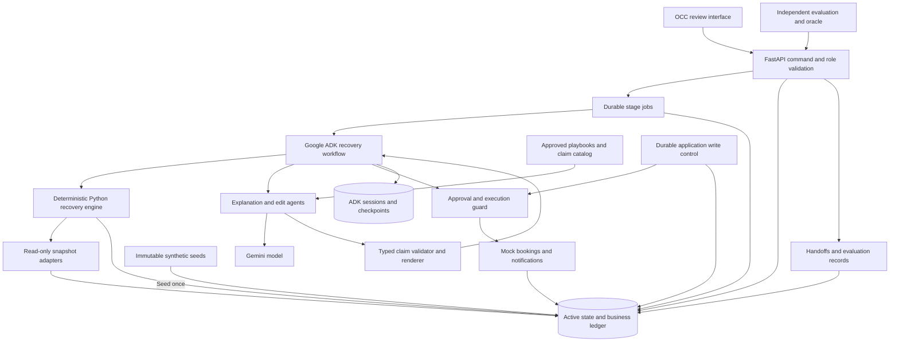
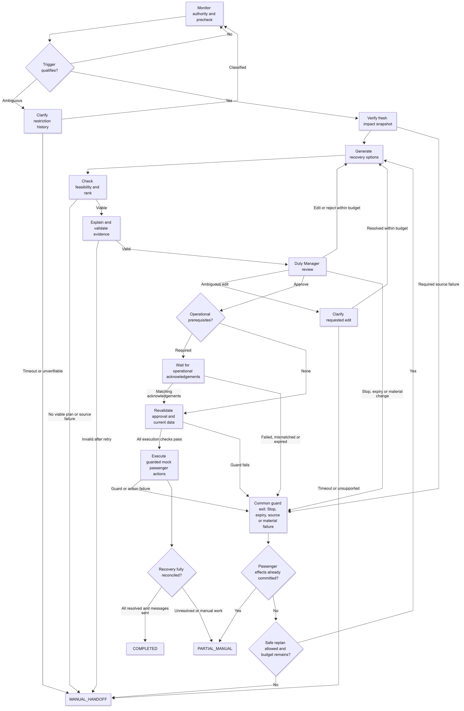
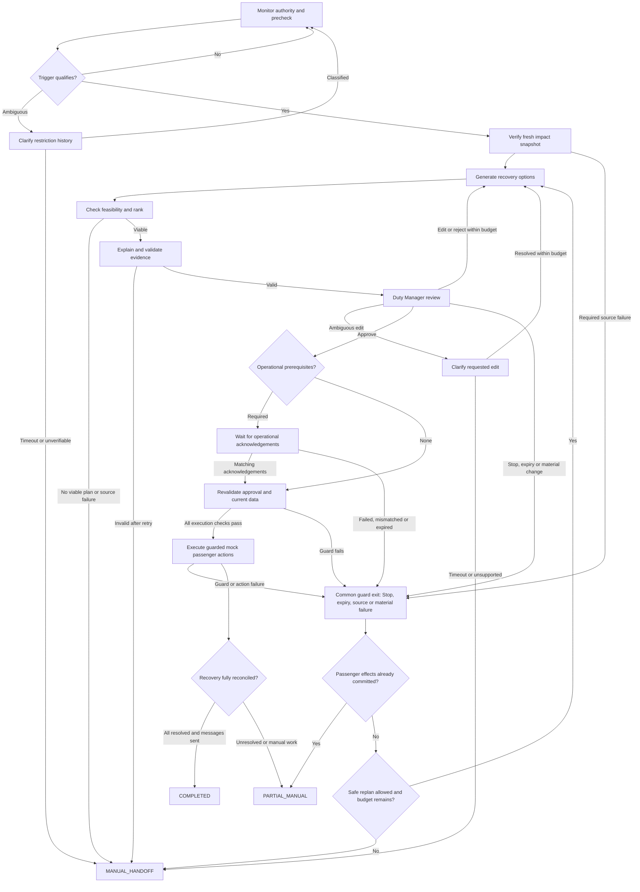

# HubRecover architecture with Google ADK

**Design baseline:** 11 October 2026. **Status:** architecture only; no ADK application, datasets, deployment, or measured evaluation exists yet.

**Review revision:** Findings A1–A9 from [ARCHITECTURE-REVIEW.md](ARCHITECTURE-REVIEW.md) are addressed by the design contracts in sections 17–25. They still require implementation and the verification listed in section 26. PRD sections 14, 15, 20, 23, and 24 carry the shared product decisions; the extra backend resource and recovery mechanisms are specific to this ADK profile.

Build HubRecover as a Python application with a Google ADK graph workflow, a deterministic recovery engine, a Duty Manager web interface, and transactional mock passenger systems. ADK coordinates bounded tasks and human pauses. Application code owns operational truth, feasibility, ranking, authorisation, and writes.

The product and acceptance requirements remain in [PRD.md](PRD.md); [TEST-PLAN.md](TEST-PLAN.md) defines the shared evaluation. This document selects the implementation architecture for the separately run ADK prototype. All airline data and operational actions remain synthetic. One episode at one hub, 18 day-one flights, six next-day alternatives, and 300 affected reference passengers remain the initial scope.

## 1. Runtime decision and the LMS constraint

There are two delivery profiles with the same product rules:

| Concern | ADK prototype: architecture selected here | LMS browser demonstration: existing kit |
| --- | --- | --- |
| Runtime | Python backend plus a web interface | One standalone HTML page with JavaScript |
| Orchestration | ADK `Workflow` plus domain transition guards | JavaScript state machine |
| AI access | Server-side Gemini integration | Unchanged `PFAI.generate` helper |
| Operational data | Immutable JSON seeds loaded into ledger-owned active state | Embedded seeds and versioned active records |
| State | Durable business ledger and ADK session storage | Visit-only memory and explicit downloads |
| Opening/deployment | Start local server; optional separate cloud hosting | Double-click `index.html`; LMS ZIP upload |
| Role checks | Explicit simulated roles locally; authenticated roles before shared use | Simulated roles only |

The LMS frame cannot call this backend or run Python. An ADK application cannot be submitted as the existing `prototype.zip`. BUILD-PROMPT.txt, BUILD-INSTRUCTIONS.md, and HOSTING-CONTRACT.md govern only the LMS profile. Browser-specific PRD implementation statements describe that profile; the ADK profile replaces their runtime and persistence mechanisms, while preserving all behavioural controls and evaluation gates. Backend evaluation does not establish browser-profile correctness, or vice versa.

Build the ADK prototype first for the requested architecture. If an LMS artifact is later required, reuse versioned fixture exports, policy values, interface design, and independently specified test expectations. A JavaScript port must pass the same conformance cases; it does not inherit a Python test pass.

## 2. Technology choices

| Layer | Choice and reason |
| --- | --- |
| Interface | Plain HTML/CSS/JavaScript served by the application; reuse the Operations appearance in DESIGN.md. A separate frontend framework is unnecessary for the first loop. |
| API | FastAPI with typed request/response contracts; commands, role checks, version checks, and read-only progress streaming. |
| Orchestration | Google ADK Python graph workflows: fixed routes containing functions, AI nodes, and human-input nodes. |
| AI | Two bounded Gemini-backed `LlmAgent` instances: explanation and edit interpretation. Model identifier is configuration, frozen before evaluation. |
| Domain engine | Pure Python calculations and validators independent of ADK, HTTP, and model calls. |
| Local storage | SQLite business ledger plus a separate SQLite ADK session database; one process/worker owns the synthetic episode. |
| Shared deployment | Optional Cloud Run application, Cloud SQL PostgreSQL ledger/session storage, and Cloud Tasks dispatch of bounded worker stages. |
| Retrieval | Versioned local playbooks filtered by approval, currency, scope, and strategy. No vector database is needed for the small corpus. |
| Evaluation | Independent oracle, deterministic conformance tests, ADK explanation/edit evaluation, and human/baseline comparisons. |

The inspected ADK Python release is [v2.11.0](https://github.com/google/adk-python/releases/tag/v2.11.0). Use `google-adk[db]==2.11.0` as the initial implementation target and lock dependencies after an executable compatibility check; this design does not claim that version has been installed or tested. ADK documents graph nodes for code, agents, tools, and human input, with explicit branching and joins. [ADK graph routes](https://adk.dev/graphs/routes/).

Prefer a modular application over separate network services for every specialist role. This keeps one recovery decision, its evidence, and execution controls inspectable while preserving adapter boundaries for later integration.

## 3. Component architecture



[Open full-size diagram](diagrams/hubrecover-components.svg) · [Mermaid source](diagrams/hubrecover-components.mmd)

<details>
<summary>Editable Mermaid diagram</summary>



</details>

Operational adapters read immutable snapshots of ledger-owned active state. JSON is seed data; labelled driver commands atomically update active records and versions. Simulated specialist acknowledgements use this same protocol, with the matching approved prerequisite. The execution service can modify only synthetic passenger bookings, inventory, and approved notification records, through the application control and transaction guards. The model has no booking tool.

Progress events are projections of persisted business transitions. The browser cannot supply its own successful gate result, actor authority, calculated metric, or completed booking.

## 4. Specialist roles and ADK mapping

| PRD role | ADK/application implementation | Output and authority |
| --- | --- | --- |
| Supervisor | `RecoveryWorkflow` graph, deterministic router functions, and guarded ledger transitions | Sequences approved stages; enforces budgets and exception paths. Routing is never chosen by an LLM. |
| Monitoring Agent | Event receiver and Python episode reducer, outside long-running model invocations | Validates authority history and emits one qualifying trigger; no writes to operations. |
| Impact Analysis Agent | Read-function nodes and a snapshot-validation/impact node | Verified snapshot, causal flight cascade, affected cohort, resource conflicts, and fact IDs. |
| Recovery-Options Agent | Candidate/allocator/ranker functions plus `ExplanationAgent`; separate edit branch uses `EditInterpreterAgent` | Deterministically ranked plans; grounded explanations; proposed supported constraints. |
| Policy Gate | Pure Python validation functions before display and execution | Passed/failed/unknown configured checks with evidence. Unknown required checks block. |
| Re-accommodation Agent | Guarded execution function nodes invoking application services | Atomic mock party bookings, approved messages, retries, and cohort reconciliation. |

Only two components are LLM agents. The other “agent” names describe specialist responsibilities. They do not require independent models, free-form delegation, A2A, or MCP infrastructure.

Configure both LLM agents for `mode="single_turn"`, typed input, `output_schema`, and no operational tools. Retrieve and calculate context before the model call. ADK supports structured output, but tool/schema combinations are model-dependent, and invalid responses can remain in session output. HubRecover therefore independently parses and validates every response before use. [ADK LLM agent configuration](https://adk.dev/agents/llm-agents/).

## 5. Recovery workflow



[Open full-size diagram](diagrams/hubrecover-workflow.svg) · [Mermaid source](diagrams/hubrecover-workflow.mmd)

<details>
<summary>Editable Mermaid diagram</summary>



</details>

This diagram shows the main paths and a common guard exit. Every stage uses the transition contract in section 20, including routes omitted for readability. Before any passenger effect, an unexpected material change or expired card can replan within the remaining two-regeneration budget; Stop, disabled writes, unverifiable required sources, or exhausted budgets hand off. After committed passenger effects, preserve those results and reconcile remaining work to `PARTIAL_MANUAL`; there is no global rollback or automatic further rebooking. Trigger classification resumes the episode reducer and precheck.

**Monitoring.** Apply PRD event semantics in a pure reducer: strictly greater than 60 minutes, at least two affected downline flights or one verified crew conflict, applicable confirmed active weather restrictions only, and one trigger per episode. A lift shorter than 15 minutes preserves duration but cannot newly trigger while lifted; a lift of exactly 15 minutes resets. Version ordering, duplicates, and ambiguous late history follow PRD section 3. A tick/event invokes short code work; no LLM waits for an hour or polls the feed.

**Snapshot and impact.** Capture one consistent ledger snapshot before parallel adapter reads; every node reads that immutable snapshot ID (section 19). The join is a completion barrier; the validator checks envelopes, references, freshness, and material versions. Dispatch evidence must match each proposed operation; a generic verified flight record cannot validate a changed operation. Failure of a required branch ends the round. Preserve affected-passenger and fact sets as immutable versioned records.

**Plan.** Enumerate the versioned finite universe in section 17, with at most 100 selected constructions and a 20-actual-second deadline. Each regeneration takes a fresh coherent snapshot and preserves constraints, rejection fingerprints, and remaining budgets. Automatic regeneration is available only before committed passenger effects. Allocate whole parties by original scheduled final arrival and then party ID; choose eligible itineraries by final arrival and flight IDs. Allocation must also be feasible in execution order under section 18. Unknown assistance, broken continuity, unavailable resources, inadequate seats, or unsupported eligibility block the relevant allocation/plan.

Rank viable plans lexicographically by `(unresolvedPassengers, nextDayArrivals, totalPassengerArrivalDelayMinutes, cancelledFlights, totalFlightDepartureDelayMinutes)` and canonical fingerprint. Retain up to four viable plans plus one disabled rejected example. One viable plan is enough; zero routes to a human. No model modifies this objective or writes the allocation.

**Explain.** Retrieve current in-scope precedents and supply only verified facts, metrics, allowed plan IDs, and eligible excerpts. One bounded batch call selects typed claims and reason codes for up to four viable plans. Section 21 validates these selections and renders all displayed language from approved templates; arbitrary model prose is excluded. `LIMITED_PRECEDENT` is an explicit evidence condition and can use a code-generated factual explanation; it is not an AI-error fallback. Failed real-AI responses remain failures.

**Review, acknowledge, revalidate, execute.** Persist plan cards before requesting input. Approval selects the exact immutable version. Await all required specialist/assistance acknowledgements, compare expected committed postconditions, rerun the gate, and then commit only the approved passenger allocation. Communicate successful bookings, retained confirmed itineraries, and approved unresolved outcomes separately. No inferred operational commitment or promised replacement for an unresolved passenger is allowed.

## 6. AI contracts and grounding

Use strict Pydantic models with extra fields forbidden. The following are proposed application contracts, not already implemented schemas:

| Contract | Fields and validation |
| --- | --- |
| `ExplanationInput` | Episode/generation, snapshot ID and context digest, existing plan/strategy IDs, typed facts, eligible precedents, ranking and warnings, approved claim/reason catalog version. No raw contacts or full manifest. |
| `ExplanationOutput` | A batch of existing plan/strategy IDs, bounded typed fact/comparison claims, approved reason codes, and eligible precedent IDs. No free-form prose, invented values, allocation, approval, or tool-call fields; see section 21. |
| `EditInput` | User request, current plan/version, allowed edit kinds, and relevant known flight/connection/passenger/party IDs. |
| `EditProposal` | Discriminated supported constraint (`protectFlight`, `protectConnection`, `maxArrivalDelay`) or `needsClarification` with a reason. IDs must resolve; minute values must satisfy the policy schema. |

The edit branch is `interpret → validate proposal → show interpreted constraint → regenerate`. Natural language cannot turn into a SQL query, arbitrary function name, compensation action, or policy change. The resulting card must show the applied constraint for review. Ambiguous references require clarification; unsupported edits are never approximated.

Source existence is necessary but insufficient for grounding. Section 21 recomputes comparisons, verifies reason predicates and scope, and rejects unknown or contradictory claims before rendering. Independent evaluation and human review still assess claim support and usefulness, including noncritical rendered conclusions. The model cannot grade itself or set `GROUNDED` by naming sources.

Use a configured Gemini Flash-class model as the initial latency/cost candidate. Resolve an available explicit model version for the selected endpoint during implementation, record it, and freeze it before final evaluation; do not silently move a `latest` alias during comparisons. ADK provides Gemini model configuration and authentication options. [ADK Gemini integration](https://adk.dev/agents/models/google-gemini/). Do not store credentials in the frontend, fixtures, traces, or repository. Local secrets stay in server environment configuration; shared hosting requires managed server credentials and restricted access.

## 7. Business ledger and ADK session state

The business ledger is the source of truth. ADK session state contains IDs and bounded working context; it cannot itself grant booking authority. ADK supports persistent relational session storage through `DatabaseSessionService`, including SQLite with an async driver. This is distinct from HubRecover's business transactions. [ADK sessions](https://adk.dev/sessions/session/).

| Ledger record | Required purpose |
| --- | --- |
| `episodes`, `restriction_events` | Scoped ordered history, one trigger, status/version, stop flag, policy/data versions, both clocks. |
| `snapshots`, `facts` | Immutable material source content, evidence IDs, freshness timestamps, and provenance. |
| `plans`, `constraints`, `rejections` | Immutable plan versions, exact actions/allocations, ranking, gates, prerequisites, fingerprint, creation and expiry. |
| `review_requests`, `approvals` | Pending request ID, ADK invocation mapping, selected version, actor/role, permitted actions, material versions, decision idempotency key. |
| `operational_acks` | Per-prerequisite reference, expected postcondition, matching committed version, actor, status, and evidence. |
| `inventory`, `bookings`, `execution_actions` | Capacity versions, confirmed itineraries, action keys, attempt/result state, and own-batch deductions. |
| `notification_outbox`, `handoffs` | Approved immutable payloads, dispatch attempts/receipts, manual-contact and specialist ownership. |
| `stage_jobs`, `trace_events` | Persisted continuation, lease/deadline, fencing version, and append-only application event history. |
| `scenario_state`, `source_versions`, `stage_results` | Authoritative mutable source records, atomic change classification, and immutable stage results for crash recovery. |
| `application_control`, `incidents`, `model_usage` | Durable write-disable state, restoration evidence, and reserved/observed call and token budgets. |
| `eval_suites`, `eval_runs`, `eval_results`, `verdicts` | Frozen evaluation manifests, observed outcomes, automatic diagnostics, and separately entered human verdicts. |
| `reviewer_scores`, `comparison_tasks`, `feedback` | Reviewer expertise and rubric evidence, matched task timings, and version-linked improvement records. |

Enforce database uniqueness for authority event/version, episode trigger, review decision key, booking action key, and notification action key. Define indexes and foreign keys in implementation. ADK and business storage may use separate databases locally and separate schemas on one PostgreSQL service later; do not modify ADK-owned tables to add airline business records.

Plans use canonical operational/allocation fingerprints; prose changes do not create new candidates. Approval additionally binds plan version, constraints, policy, source material digests, prerequisites, and authorised notification templates. Hashes identify content; they are not authentication signatures.

No cross-episode learned preference, automatic playbook promotion, or long-term passenger memory is needed. Persisting synthetic local records improves restart testing; it does not establish production audit integrity or an approved retention policy. Provide explicit synthetic-run cleanup and redacted trace export.

## 8. Human input, approval, and restart safety

ADK graph human-input nodes can yield `RequestInput` with a payload and response schema, pausing until a reply. Use this to represent Duty Manager review and clarification. The pause is orchestration, not proof of identity, permission, or current plan validity. [ADK human input](https://adk.dev/graphs/human-input/).

1. In one business transaction, save the immutable plan/card, expiry, and pending review request. Associate the request with the episode and ADK session/invocation; reconcile this mapping after a crash.
2. Return the card and review request ID to the UI. The UI posts a structured Approve/Edit/Reject command, expected episode/plan version, and idempotency key.
3. The API derives the actor/role from its trusted context. Local capstone roles are explicitly simulated; role selection by a local driver is not production authentication. Shared use needs actual identity, episode-scoped permissions, and separate demo-driver access.
4. Under a short ledger transaction, reject stale/expired/superseded requests, wrong roles, altered constraints, unsafe plans, or inconsistent source versions. A duplicate identical command returns the recorded result; reuse of its key with different content is rejected.
5. Persist the decision and next-stage job together. Only a validated command is translated into the matching ADK input reply. An arbitrary message or “approved” in model history is never sufficient.
6. The resumed stage reloads ledger state and runs guards again. A restart, repeated reply, or copied session cannot create a second decision or action.

Enable resumability through an ADK `App` configuration and pin the workflow version for an active episode. ADK documents that resumed tools can run more than once; therefore every effect still needs application idempotency. [ADK resumability](https://adk.dev/runtime/resume/). An ADK checkpoint and the business transaction are not one atomic commit: durable stage jobs plus a reconciler must repair gaps between them, using recorded domain state rather than blindly replaying effects. Prove human-pause/restart behaviour with the pinned release before relying on it.

Do not hold an HTTP request, database transaction, or inventory lock during human review. Progress streaming is read-only and reconnectable. ADK v2.11.0 cancels its built-in `/run_sse` run on client disconnect; the production-shaped UI therefore subscribes to HubRecover's persisted event stream while a separate stage worker owns execution. [ADK v2.11.0 cancellation notes](https://github.com/google/adk-python/releases/tag/v2.11.0). Closing a browser must not be interpreted as a completed booking or silently destroy continuation state.

## 9. Transactional mock execution

For each whole-party booking action:

1. Load the approved action from the ledger, not from model output or a client payload.
2. Begin a short transaction; verify the active episode/version, Stop flag, approval expiry, prerequisite postconditions, current material source digests, and remaining execution deadline.
3. Lock the control/episode, active bookings, and union of old/new inventory rows in stable order. Apply the net seat change in section 18; shared legs consume no extra seats. Validate the entire party and every leg.
4. Commit the replacement, supersede its old booking history, apply net capacity changes, and insert the uniquely keyed receipt, approved notification outbox, and trace atomically. Recheck deadlines and fencing at the final guarded commit.
5. On duplicate delivery, return the existing receipt. A failed transaction leaves the original booking and inventory unchanged. Before any committed effect a conflict may replan; after progress, preserve completed results and end unsafe remaining work in `PARTIAL_MANUAL`.

Use conditional version checks/transactions appropriate to SQLite locally and PostgreSQL later. A single worker helps sequencing but is not a substitute for database constraints. Restriction updates, Stop commands, and execution actions share the episode version/locking protocol, so a concurrent Stop or invalidation prevents later new commits. No locks span model calls or human waiting.

Expected approved operational changes and the batch's own inventory deductions are tracked explicitly. An acknowledgement matching the approved delay/tail/crew change may advance a source version without a new plan decision; unexpected changes invalidate approval. Refreshing unchanged material content can restore source freshness but never extends the card deadline.

Notification workers render fixed templates using verified IDs/times and permitted phrases. They cannot interpolate passenger names, raw source text, edit requests, or AI explanations. Before each dispatch, check authorisation, expiry, Stop, the applicable confirmed booking/retained/unresolved result, and previous receipt. Retry a known-safe communication failure at most twice within the authorised window, independently of booking. A timeout with unknown delivery requires receipt reconciliation or manual contact, not an unbounded resend. All delivery remains a local mock in this prototype.

Create retained-itinerary and unresolved-case outbox entries through separately guarded approved actions; neither requires inventing a successful rebooking. Every affected passenger must reconcile to one booking outcome and a separately tracked communication outcome.

These guarantees cover the transactional synthetic adapters. A future external PSS would require documented capacity holds/conditional commits, idempotency keys, receipt/status lookup, and a protocol for operational changes between read and commit. Local transactions cannot provide atomicity across an airline's external systems. No live writes should be enabled until those adapter guarantees are demonstrated in shadow/pilot testing.

## 10. Clocks, budgets, and failure outcomes

Use an injectable scenario UTC clock for restriction history and operational freshness. Use actual elapsed time for processing, waiting, card expiry, and attempts. Persist server UTC card creation/expiry so a restart cannot renew a card; use a monotonic timer for active in-process durations. UI clock manipulation cannot authorise execution. Synthetic clock advancement is a labelled driver action.

| Control | PRD value |
| --- | --- |
| Operational snapshot / authority heartbeat age | At most 120 / 30 scenario seconds |
| Adapter / planning-round deadline | 10 / 120 actual seconds |
| Enumeration | At most 100 candidates and 20 actual seconds |
| Regeneration / AI retry | At most two additional rounds / one AI retry within each round |
| Card and approval | 300 actual seconds from card generation; approval never extends it |
| Clarification / acknowledgement waiting | Remaining card window; pre-card clarification at most 300 actual seconds |
| Execution attempt / notification attempts | 120 actual seconds / at most two per passenger/channel within authorisation |

One versioned product policy config feeds backend checks and UI displays; an additional frozen ADK runtime config supplies section 24's model/resource ceilings. Enclosing deadlines win; restart and framework/network retries consume persisted budgets. Disable hidden model/client retries beyond the explicit allowance.

Unavailable required data, ambiguous history, zero viable options, unsupported critical claims, acknowledgement failure, exhausted budgets, and expired approval lead to the PRD's clarification/replan/manual paths. `COMPLETED` requires a resolved confirmed itinerary for every affected passenger and every required communication sent. Planned unresolved cases, missing contacts, or partial failure lead to `PARTIAL_MANUAL`, even if all attempted automated actions succeeded. Stop disables new actions and preserves completed ones; Reset starts a fresh episode after stop/finish with no inherited approval.

## 11. Application API and UI

These are HubRecover application endpoints, not claims about ADK's built-in API:

| Endpoint | Behaviour |
| --- | --- |
| `POST /demo/runs` | Create an isolated seeded synthetic run; separate test/demo namespaces. |
| `POST /demo/runs/{id}/events` | Labelled driver injection of authority ticks, source updates, acknowledgements, or failures; never exposed as an LLM tool. |
| `GET /runs/{id}` | Current state, source ages, clocks, cards, prerequisites, outcomes, and remaining budget. |
| `GET /runs/{id}/events` | Redacted reconnectable progress stream with event cursor. |
| `POST /runs/{id}/review` | Version-bound Approve/Edit/Reject command; valid review request and idempotency key required. |
| `POST /runs/{id}/clarification` | Reply only to the matching pending exception request. |
| `POST /runs/{id}/stop` | Durable stop command; blocks later new actions. |
| `POST /runs/{id}/reset` | Create a fresh isolated episode after a stopped/finished run; no prior authority copied. |
| `GET /runs/{id}/trace` | Redacted trace/results download; cannot be imported as authorisation. |
| `GET /runs/{id}/handoffs` | Owned packets, pending acceptance, affected parties, and remaining work. |
| `POST /handoffs/{id}/accept`, `POST /handoffs/{id}/assign` | Version-bound simulated owner acceptance or authorised reassignment; does not resolve a passenger. |
| `POST /handoffs/{id}/resolution` | Owner records evidence of manual handling; verified source/outcome changes use their separate guarded commands. |
| `POST /eval/suites/{id}/runs`, `GET /eval/runs/{id}` | Evaluator-only execution and observed results, separate from demo authority. |
| `POST /eval/results/{id}/verdict`, `POST /reviews` | Human verdict and reviewer rubric/expertise records; never generated by the model. |
| `POST /comparisons`, `POST /feedback`, `GET /eval/suites/{id}/export` | Matched task evidence, version-linked feedback, and a results bundle with denominators/unrun checks. |
| `GET /control`, `POST /control/disable`, `POST /control/restore` | Durable application-wide write control; restricted roles and restoration evidence in section 25. |

Return explicit validation/conflict/expiry states in ordinary UI language. Use the same five visible stages from DESIGN.md, followed by acknowledgement, execution, and reconciliation. Display rejected options disabled; deterministic metrics, evidence labels, critical warnings, simulated roles/actions, and sample/rules-only/real-AI mode must remain visible.

For shared hosting, add authenticated access, role checks on every command, origin/CSRF controls appropriate to the session mechanism, and request limits. Do not expose generic ADK run/session mutation endpoints to the Duty Manager UI as a way around the domain API.

## 12. Evaluation and observability

Carry forward PRD section 20 and TEST-PLAN.md without reducing their gates. ADK's trajectory and response/rubric metrics help evaluate agent behaviour; they do not prove aircraft feasibility, seat accounting, valid approval, or product value. Use custom domain assertions and the independent oracle for those requirements. [ADK evaluation criteria](https://adk.dev/evaluate/criteria/).

| Evaluation layer | Required evidence |
| --- | --- |
| Fixture/domain conformance | Schema/foreign-key/invariant checks; exact trigger scripts; hard-rule recalculation; deterministic party allocation, ranking, and passenger accounting. |
| API/storage failure tests | Wrong role/version, double-click, expired card, invalid acknowledgement, inventory race, Stop race, crash before/after booking commit, crash after approval before ADK resume, and notification uncertainty. |
| AI contract tests | Unsupported/ambiguous edits, unknown evidence IDs, injected source instructions, numerical changes, unsupported critical claims, refusal/error paths, and bounded retries. |
| Final quality set | 18 visible development families and 20 separately held-out variants; freeze data/policy/prompt/retrieval/model/oracle versions; three repeats for AI-dependent final cases. Labels and oracle outputs stay outside model context. |
| Human/value comparison | At least two reviewers and ten tasks; manual versus HubRecover and rules-only versus AI-assisted comparisons with equivalent facts and counterbalanced order. |

Zero unauthorised writes, hard-rule overrides, prerequisite bypasses, oversold seats, duplicate bookings, false confirmations, or false completion are mandatory. Every selectable option must independently pass the configured checks. Ranking must meet the PRD's at-least-90% best-equivalence-class target; cited IDs and critical claims must all be supported and noncritical claim support must reach at least 90%.

Measure nearest-rank P95 threshold-to-first-valid-card at most 300 actual seconds over at least 30 qualifying runs, while reporting failures/handoffs/timeouts separately. Human review requires at least 80% of cards scoring at least 4/5 on each required dimension and zero missed critical warnings. Product value remains unproven until the matched manual comparison demonstrates at least 50% lower median task time with no worse quality/outcome. Safety failures cannot be averaged away. Report false handoffs and useful coverage, not just successful runs.

Trace episode/job/invocation/plan IDs, domain transitions, material/policy versions, gates, ranking tuples, decisions, acknowledgements, execution receipts, and communication state. Record model/prompt version, tokens, latency, retries, and mode. Separate model time, deterministic processing, human review, acknowledgement wait, and execution. Exclude credentials, raw contacts, unnecessary names, and full manifests. ADK traces supplement the business trace; they cannot substitute for booking receipts or the approval ledger.

## 13. Local and optional cloud deployment

**First build:** one Python application serving the UI/API, one local stage-worker loop, two SQLite stores, fixture JSON, and server-side Gemini configuration. A stopped process resumes from persisted jobs after rechecking deadlines and ledger state. No real airline access, messaging, paid infrastructure, or deployment is required to demonstrate the design.

**Optional hosted synthetic demo:** package the same application for Cloud Run, use Cloud SQL PostgreSQL with separate business/ADK ownership, and dispatch bounded stages through authenticated Cloud Tasks HTTP requests to a restricted worker route. Cloud Run supports ADK hosting, Cloud SQL documents the database connection, and Cloud Tasks supports configurable HTTP tasks. These are selected deployment components, not resources already provisioned. [ADK Cloud Run deployment](https://adk.dev/deploy/cloud-run/), [Cloud Run agent hosting](https://docs.cloud.google.com/run/docs/ai-agents), [Cloud SQL connection](https://docs.cloud.google.com/sql/docs/postgres/connect-run), [Cloud Tasks HTTP dispatch](https://docs.cloud.google.com/tasks/docs/creating-http-target-tasks).

Persist a stage job/outbox entry in the business transaction, then dispatch it to Cloud Tasks. The queue operation and SQL commit are separate: a reconciler retries undispatched jobs, and workers deduplicate using the ledger. Queue retries do not renew approval, restart budgets, or repeat committed actions. Schedule expiry/reconciliation jobs and recheck overdue records whenever the application processes a command or worker request; queue delay can cause a truthful expiry/manual outcome. Human pauses remain persisted records, not running requests. Work executes within a bounded worker request; do not rely on an untracked background coroutine surviving a serverless request.

Keep credentials server-side, restrict shared access, and bound concurrency by an episode lease/fencing version. Add operational monitoring and approved retention before any real-data shadow trial. Cloud hosting alone does not turn the fictional rules into airline-approved constraints. Agent Engine, GKE, distributed agent services, search infrastructure, and live airline adapters are unnecessary for the first prototype.

## 14. Proposed source layout

This is a proposed layout; these application files have not been created.

```text
adk-prototype/
  pyproject.toml                 # pinned dependencies and lockfile
  hubrecover/
    app.py                      # FastAPI, UI routes, command validation
    workflow.py                 # ADK graph, routers, human-input nodes
    agents/
      explanation.py            # bounded schema-output LLM agent
      edit_interpreter.py       # supported-edit LLM agent
    domain/
      models.py                 # source/plan/decision contracts
      episodes.py               # event reducer and trigger
      impact.py                 # causal schedule/passenger calculations
      candidates.py             # bounded template enumeration
      allocation.py             # whole-party itinerary allocation
      policy.py                 # hard checks and freshness
      ranking.py                # objective and canonical fingerprint
      approval.py               # binding, expiry, material-change checks
      execution.py              # guarded actions and reconciliation
    adapters/                   # fixture reads, mock PSS and messaging
    storage/                    # ledger, transactions, outbox, migrations
    worker.py                   # leases, stage jobs, restart reconciliation
    control.py                  # application-wide write disable and incidents
    handoffs.py                 # ownership, acceptance, manual-work packets
    evaluation_records.py       # observations, verdicts, comparisons, feedback
    web/                        # Operations UI and progress client
  fixtures/                     # immutable versioned seeds and claim catalog
  config/                       # frozen recovery universe and runtime budgets
  evaluation/
    oracle/                     # separately implemented calculations
    development/                # 18 visible families
    held_out/                   # evaluator-only labels, 20 variants
  tests/                        # domain/API/transaction fault tests
```

Expose only filtered case inputs to the runtime. Do not mount evaluator labels into retrieval or prompts. ADK development tools can help inspect agents, but the product demo uses the guarded OCC interface.

## 15. Build order and completion gates

1. **Data and deterministic engine.** Implement schemas, policy config, invariant checker, seeded reference data, event reducer, impact, candidates, allocation, and independent oracle. Gate: correct trigger boundaries and independently feasible/ranked reference plans.
2. **Guarded workflow and review UI.** Wire function nodes, active-state/version protocol, durable fenced jobs, immutable cards, supported edits, approvals, simulated acknowledgements, expiry, Stop, global write control and owned handoffs. Gate: no passenger writes through invalid approval, disabled control or missing prerequisites.
3. **Mock execution and restart tests.** Add net-seat party replacement transactions, superseded booking history, outbox, independent communication retry, reconciliation, and every crash/race boundary. Gate: no oversell, duplicate action, lost completed booking, or false completion.
4. **Bounded Gemini agents.** Add explanation/edit branches, filtered retrieval, typed claim catalog/validator/renderer, persisted resource reservations, error handling, and frozen AI versions. Gate: no new model authority; sample and real-AI evidence remain distinct.
5. **Final evaluation and demonstration.** Implement observed-result/verdict/reviewer/comparison/feedback records and exports; run development and held-out suites, repeated AI cases, reviewer tasks, and manual/rules-only comparisons. Gate: observed evidence for mandatory safety and PRD quality/value gates, or an explicit report of unmet gates.

The first demonstration should show a qualifying weather episode, an independently rejected unsafe candidate, a protected-connection edit, current approval, matching operational acknowledgements, final checks, mock rebooking/messages, and reconciled outcomes. A second run should show stale approval or an unacknowledged change blocking passenger actions. Passing this demo is evidence of the mechanism; final evaluation is still required.

## 16. Architecture trade-offs and remaining validation

The central trade-off is controlled scope: bounded deterministic templates make safety and ranking auditable, but do not solve network-wide optimisation. Two small AI roles can improve comprehension and edit entry; the rules-only comparison must establish whether that benefit justifies model latency, cost, and failure modes.

Durable backend state enables crash/replay tests and real API permissions, while introducing migrations, worker recovery, and identity responsibilities absent from the browser profile. The ledger/outbox protocol is essential because ADK checkpoints, business commits, and future external receipts are separate operations. The local synthetic version cannot demonstrate external-system atomicity.

Before implementation sign-off, verify the pinned ADK graph, structured-output and human-resume APIs with a small executable spike; select/freeze the exact available Gemini model; demonstrate all declared fixture invariants; and test approval/commit/crash boundaries. Before any airline pilot, validate the discovery hypothesis, actual operating rules and authority, adapter guarantees, identity, data handling, human staffing, and measured baseline. These are unresolved validation tasks, not completed capabilities or reasons to stop designing the synthetic prototype.

## 17. Finite candidate-universe contract — A1

`RECOVERY_UNIVERSE_V1` is a fictional teaching specification, recorded in `recovery-universe.json` and frozen with policy and fixtures. It defines the complete bounded search, rather than promising network optimisation.

| Construction property | V1 rule |
| --- | --- |
| Horizon and flight set | From declared `hubServiceDayStartUtc` through the following 48 actual UTC hours. Remaining departures satisfy `start <= departure < end`; arrivals satisfy `departure < arrival <= end`. Completed prefixes stay fixed. Use only the 18 declared day-one flights and six declared next-day alternatives; no invented flights, durations, release times, or positioning legs. |
| Roots | Affected day-one flights not already departed or committed cancelled, sorted by flight ID. Completed legs are fixed. There are at most 18 roots. |
| `DELAY` | One root delayed by 30, 60, 90, or 120 minutes from its latest known scheduled/estimated/committed departure. Preserve verified block duration. Propagate later times along its existing aircraft rotation and crew pairing using verified durations and configured minimum intervals until stable; infeasible availability/duty/continuity still rejects the plan. A forecast restriction end is never a confirmed release. |
| `SWAP` | Replace one root's aircraft rotation suffix with one of at most two available compatible same-type spare tails, chosen by ascending tail ID. Verify location, availability, maintenance and the entire suffix. Do not exchange occupied tails, invent ferry flights, or introduce a crew reassignment. Required resulting operational changes still need acknowledgements. |
| `CANCEL_SINGLE`, `CANCEL_PAIR` | Cancel one root or one unordered pair of distinct roots. Remove those operations and independently validate the remaining resource continuity. Re-accommodate their affected parties using verified alternatives. No implied aircraft relocation or additional cancellation is permitted. |
| Combinations | Each construction selects exactly one family descriptor. No arbitrary delay-plus-swap, triple cancellation, or other composite search in V1. Derived timing propagation and passenger allocation belong to that construction. |
| Remaining itinerary search | Enumerate all eligible simple paths of one or two remaining legs in the declared flight set, from the party's verified disruption location to its original final destination. Preserve completed prefixes, exclude cancelled/ineligible legs and airport revisits, check all connections and assistance, and sort by final arrival then flight IDs. Original scheduled final arrival remains the delay/priority baseline. |

Construct descriptor lists in family order `DELAY`, `SWAP`, `CANCEL_SINGLE`, `CANCEL_PAIR`. Within families sort respectively by `(rootId, delayMinutes)`, `(rootId, spareTailId)`, `(rootId)`, and `(firstRootId, secondRootId)`. Take one descriptor per nonempty family in round-robin order until 100 are selected or all lists are exhausted. With 18 roots and two eligible spare choices each, the raw maximum is `72 + 36 + 18 + 153 = 279`; selection is fixed before candidate calculation.

Materialise and evaluate every selected descriptor, apply supported constraints and rejection fingerprints, then deduplicate by canonical operational-actions-and-passenger-allocation fingerprint. A failed, duplicate, or rejected construction does not cause an omitted descriptor to be added. This keeps production and oracle selection identical and limits distinct candidates to 100. The bounded universe `U` is the selected, materialised set for this snapshot and config, including rejected candidates; the larger raw set is outside the optimality claim.

Canonicalise the versioned action/allocation schema as UTF-8 JSON with sorted object keys and no insignificant whitespace. Normalise times to integer UTC epoch milliseconds; identifiers sort by Unicode code point. Sort operations by kind/resource ID and allocations by party/passenger ID, preserving itinerary leg order. Include all proposed resource/time changes and outcome/leg/cabin allocations; exclude plan/generation IDs, prose, source timestamps and ranking annotations. Hash with SHA-256. Constraints, policy and source digests bind approval separately; changing wording, generation or a constraint without changing actions cannot evade a rejected fingerprint. The fixture validator rejects values outside the schema rather than rounding them.

Persist universe/config version, snapshot ID, descriptor-list hash, raw/selected/completed/distinct/viable counts, cap-applied flag, rejection reasons, and final universe digest. If the 20-second deadline prevents full evaluation, mark `SEARCH_INCOMPLETE`, publish no executable card or best-in-universe claim, and hand off. A completed search with zero viable candidates means “no viable option in the declared bounded search,” with its limits visible. New material source content creates a new generation and universe, subject to regeneration limits.

The oracle may share schemas and this declarative specification, but must implement enumeration, propagation, allocation, capacity and objective arithmetic separately. Compare descriptor selection, fingerprints, eligibility and ranking on hand-auditable small cases, exact ties, edits, and a greater-than-100 raw-construction case. Fixture authoring must establish useful reference alternatives inside `U`; neither fixture labels nor oracle answers enter runtime prompts.

## 18. Itinerary replacement and seat conservation — A2

Maintain one active booking version per passenger, with immutable superseded history. An active reservation on a cancelled flight is still a recorded reservation; it is not a resolved feasible itinerary. Whole-party changes require the expected active-booking versions of every member.

For a party replacement, lock the application control, episode, party/bookings, and union of old/new `(flightId, cabinId)` inventory rows in that order; sort IDs within each class. In the same transaction calculate:

```text
oldReserved[leg] = seats held by this party's active bookings on leg
newReserved[leg] = seats required by the approved replacement on leg
delta[leg] = newReserved[leg] - oldReserved[leg]
occupiedAfter[leg] = occupiedBefore[leg] + delta[leg]
require 0 <= occupiedAfter[leg] <= usableCapacity[leg]
```

Shared legs have zero net change. Release old reservations only in the transaction that confirms all new legs and supersedes old bookings. Releasing capacity on a cancelled flight does not make that flight eligible. Failure rolls back the whole transaction: old bookings, occupancy and outbox remain unchanged; no new itinerary is confirmed. Cancellation approval or an operational acknowledgement alone cannot release a passenger's reservations.

The transaction checks the exact approved allocation, all prerequisites and current expected material state, party cohesion, inventory versions, episode generation, worker fence, application control, Stop and deadlines. Perform the final guarded version/deadline check immediately before commit and record its server time. Concurrent source/control commands use the same lock protocol, giving a defined order for the mock commit. Never hold these locks across model calls or network delivery.

The planner must simulate transactions in the published party order, using the same net-seat accounting. Each execution prefix must be feasible: an earlier party cannot borrow capacity that a later party might release. Persist an expected inventory-version/delta vector for the batch. A matching own-batch receipt can advance that vector; unrelated mutations invalidate remaining authority. This is not merely a final-total capacity check.

Use a stable booking action key per approved party transition. Duplicate calls return its committed receipt without changing seats or sending another message. If the receipt exists after a crash, reconcile it instead of replaying the booking. Completed party outcomes are frozen for this episode. After progress, a material failure produces `PARTIAL_MANUAL`; further automatic movement requires a separately reviewed future workflow outside V1. Known-safe receipt lookup or retry of a transaction known not to have committed may continue within the original authorisation and attempt budget.

Retained and unresolved outcomes use guarded, uniquely keyed no-booking-change actions to record their outcome and approved communication. They never create a replacement receipt. `COMPLETED` still requires all passengers resolved and all required messages sent; an accepted handoff cannot satisfy that condition.

## 19. Active scenario ownership and version protocol — A3

Fixture JSON is immutable seed data. Validate it, then load operational records, passengers, bookings, inventory and acknowledgement state into the business ledger for the run. Read adapters never mutate or reread seed files as current truth. Every labelled source update goes through a typed driver command and one ledger transaction.

| Version | Meaning |
| --- | --- |
| `scenarioVersion` | Monotonic revision for every accepted source update, including verified timestamp refreshes. |
| `materialDigest` / source versions | Canonical material content and individual source revisions used to compare snapshots and execution state. |
| `episodeVersion` | Compare-and-set revision for business transitions, decisions, source effects and Stop. |
| `planGeneration` | Monotonic planning generation; invalidated generations cannot publish cards or execute. |
| `controlVersion` / worker fence | Application authorisation revision and current lease owner, independently checked on consequential worker commits. |

Capture all required active records in a short consistent database read transaction, persist immutable snapshot content and its version vector, then let parallel adapters read that snapshot ID. An update during extraction is represented entirely before or after the snapshot. Revalidate current material content before publishing a card and before each effect; consistent reads alone do not make a snapshot current.

The server classifies each update using a field-level allowlist; the client cannot label its change safe:

| Classification | Required rule and consequence |
| --- | --- |
| Nonmaterial | Only allowlisted display labels or verified envelope/heartbeat refreshes changed. Refresh requires a successful adapter verification, not a client-supplied timestamp. Freshness can recover; card expiry never extends. |
| Expected prerequisite | Plan/prerequisite/action references match the active approval and exact resulting operational postconditions. Record matching evidence, update the expected state vector, and revalidate all rules. Additional changes invalidate approval. |
| Own-batch effect | Booking/inventory change matches a committed receipt for this approved batch and exact delta. Update only the batch's expected vector. |
| Unexpected material | Changed restriction scope/status/history, flight times/status/resources, crew/tail availability/location/qualification/duty, dispatch operation result, eligibility/connections/assistance, capacity or bookings outside those exceptions. Invalidate generation/approval atomically and block subsequent effects. |
| Invalid/unknown | Missing schema, references, contradictory history or unclassified material fields block the affected episode and create source-specific handoff evidence. |

An update transaction writes records, classification, source/scenario/episode versions and any invalidation together. Snapshot comparison is content-based with explicit expected-change records, not permission inferred from a higher counter. Scenario clock advancement can make otherwise unchanged data stale. Persist genuine verification/heartbeat times so advancing or refreshing the demo clock cannot manufacture healthy sources.

## 20. Transition guards, fencing and crash recovery — A4

The business ledger is authoritative; ADK checkpoints and queue receipts are execution details. Every command checks trusted actor/role, expected episode/request/generation versions and an idempotency key. A correctly refused wrong-role, duplicate or stale command leaves domain state unchanged and records the refusal; it is not a realised safety incident.

| Command/stage | Allowed state and actor | Required guard and committed next state |
| --- | --- | --- |
| Qualifying trigger | `MONITORING`; reducer | Verified event history, impact condition and unique episode trigger → `ANALYSING`. |
| Impact / candidate / validation stages | `ANALYSING` / `GENERATING` / `VALIDATING`; current worker | Coherent fresh snapshot, current generation/fence, deadlines and complete selected search → next named stage; persist immutable stage output first. |
| Publish card | `VALIDATING`; current worker | Feasible ranked plans, validated claims, unchanged permitted material state → immutable card/request and `AWAITING_APPROVAL`. TTL starts here. |
| Approve | `AWAITING_APPROVAL`; Duty Manager | Matching pending request, plan/version/fingerprint, role, source/policy/constraint/action/template bindings and unexpired card → `AWAITING_OPERATIONAL_ACK`, or `REVALIDATING` if no prerequisites. |
| Edit/reject | `AWAITING_APPROVAL`; Duty Manager | Current request, remaining time and regeneration allowance → invalidate old request/approval, persist feedback/constraint or rejection, then `GENERATING`. Ambiguity enters `NEEDS_CLARIFICATION`. |
| Clarify | `NEEDS_CLARIFICATION`; designated human | Matching request, role, saved resume target and original deadline → monitoring classification or supported edit regeneration; no direct grant of execution authority. |
| Acknowledge prerequisite | `AWAITING_OPERATIONAL_ACK`; responsible specialist | Exact approved postcondition plus verified source commit and current deadline; all required acknowledgements → `REVALIDATING`. |
| Final gate / passenger effect | `REVALIDATING` / `EXECUTING`; current worker | Current approval, control, fence, clocks, expected state and all hard checks; final gate → `EXECUTING`, each action → receipt/outcome/outbox. |
| Reconcile | `EXECUTING`; current worker/reconciler | Read authoritative receipts and communication outcomes → `COMPLETED` only on full resolution/delivery, otherwise `PARTIAL_MANUAL` with owned work. |
| Stop / safe reset | Any nonterminal state / stopped or terminal; Duty Manager | Stop commits a durable cutoff and invalidates authority, preserving receipts; terminal result is manual or partial according to progress. Reset creates fresh IDs and no inherited approval; it cannot clear global disable. |

Required source failure, incomplete search, invalid AI after its permitted retry, unsupported clarification, explicit Stop or disabled writes routes to `MANUAL_HANDOFF` before progress. Expiry or unexpected material change before progress can return to `GENERATING` only if required sources are verifiable and a regeneration remains; no silent time extension. After committed passenger effects, failures route to `PARTIAL_MANUAL`. Explicitly record each reason. Clarification and acknowledgement timers are durable and also checked on every incoming command, so delayed timer delivery cannot preserve expired authority.

Stage jobs have stable keys `(environmentId, episodeId, planGeneration, stage, semanticActionId)`; attempts are separate records. Claim a 15-actual-second lease, renew every five seconds during active work, and increment a monotonic fencing token on takeover. Every worker result/card/review mapping, continuation dispatch, passenger effect and notification dispatch checks the current fence, expected generation/version and control in its transaction. A stale worker may only submit deduplicated usage or receipt evidence to the reconciler; it cannot publish or create new effects. Persist deadlines, retry counts, token reservations and outputs across takeover.

| Crash boundary | Required reconciliation |
| --- | --- |
| Card/request committed; ADK pause mapping missing | Reuse the saved card/request and its original expiry. Recreate or resume the mapped human pause once, using the request ID. No second card or renewed deadline. |
| Approval committed; continuation not dispatched | Find the unique pending stage job saved with approval; dispatch/resume once after current guards. Expired or invalidated approvals hand off/replan as permitted. |
| ADK reports node completion; domain result absent | Do not infer success. Look up the immutable stage result/action receipt. Rerun pure work from the same snapshot only within original budgets; missing/uncertain model output consumes its reservation and requires an allowed retry or handoff. |
| Domain stage result saved; ADK event/checkpoint missing | Reuse the stage result and map it to the invocation; no repeated model call or domain calculation required. |
| Booking committed; worker acknowledgement lost | Return the unique booking receipt and existing outbox. Preserve superseded history and capacity; never reserve again. |
| Lease takeover; old worker returns late | Reject all old-fence mutations. Reconciler can record usage/known receipts; only the current owner can advance state. |
| Notification response unknown | Look up the mock delivery receipt by stable key. Do not blindly resend; unresolved uncertainty becomes manual contact. |

Save `StageResult` before emitting its ADK event. Save `HumanReviewRequest` before pausing, and include its ID in the pause payload. Pin workflow version for pending runs; keep that version loadable or deliberately stop them with preserved evidence during an upgrade. Stop's cutoff is the accepted ledger transaction: effects committed before it remain, effects attempting to commit after it fail guards. Future external in-flight effects need receipt reconciliation; Stop is not an undo promise.

## 21. Typed explanation claims and supported edits — A5

No arbitrary model prose appears in an approval card or passenger message. `ExplanationOutput` contains exactly the requested plan IDs and these bounded fields:

```text
planId, strategyId
claims[]: {kind: FACT, factIds: [one supplied fact ID]}
       or {kind: COMPARE, factIds: [two supplied fact IDs], comparator: LT|EQ|GT}
reasons[]: {code: approved catalog enum, factIds: supplied witness IDs}
precedentIds[]: supplied eligible IDs
```

Allow at most six claims and four reasons per plan, at most four witness fact IDs per reason, and four precedent IDs in the batch. The enclosing response is bound to generation, snapshot and context digest. Strict schemas forbid extra fields, arbitrary strings for claim/reason kinds, invented numerical values and operational commands. Input facts have type, unit, metric, cohort, plan/snapshot scope and verified value; canonical facts are never values copied from a model.

The deterministic validator checks ID membership and scope, recomputes every comparison with compatible units/metric/cohort, verifies precedent eligibility, and evaluates every catalog reason predicate against its explicitly referenced witness facts. For example, `UNRESOLVED_REDUCTION` needs an actual lower unresolved count than the named alternative; `PROTECTED_CONNECTION_MET` needs all targeted passengers on independently verified legal connections; `DEPENDENCY_PENDING` needs the actual pending prerequisites. Each catalog entry fixes required witness types/cardinality and renderer arguments; no ambiguous implicit fact selection. A genuine citation supporting a false conclusion is rejected.

`explanation-catalog.json` stores human-approved predicates and display templates, including `UNRESOLVED_REDUCTION`, `OVERNIGHT_REDUCTION`, `ARRIVAL_DELAY_TRADEOFF`, `CANCELLATION_TRADEOFF`, `DEPENDENCY_PENDING`, `PROTECTED_CONNECTION_MET`, `PARTY_PRESERVED`, and `LIMITED_PRECEDENT_NOTICE`. Templates render verified values and explicit scope such as “passed the configured demo checks.” They cannot claim general legal certification, permission to execute immediately, guaranteed outcomes, or monetary commitments. Reason codes have fixed cardinality and fact requirements, not a free-text escape hatch. The complete card still displays all code-generated critical warnings even if the model omits a useful reason.

Reject an invalid batch before display; one permitted retry may correct it within the original round. Failure then hands off with the actual error. Stand-in examples use the same validator and are labelled examples. `LIMITED_PRECEDENT` remains a separately declared code-only path. Independently score all rendered factual conclusions and human comprehension; template selection can be truthful yet unhelpful, so the rules-only comparison still matters.

`EditProposal` is a strict supported constraint or a clarification-reason enum. Code checks IDs against the supplied allowed set, checks integer nonnegative minute quantities and explicit unit conversion, and verifies an unambiguous reference in the request or a confirmed UI selection. Multiple matching passengers/flights require clarification; the model cannot pick one silently. Clarification questions come from fixed templates. No raw model question, SQL, policy override, compensation request or invented action reaches execution. Show the interpreted constraint on the regenerated card and obtain fresh approval.

## 22. Owned handoff packets and acceptance — A6

Persist a handoff with `handoffId`, environment/episode/plan/generation, reason code, failed source/gate/prerequisite IDs, verified evidence, committed versus proposed actions, affected party/passenger IDs, booking/communication state, next required human action, responsible role, fallback role, status, actor and timestamps. Use `OPEN`, `ACKNOWLEDGED`, `RESOLVED_MANUALLY`, and `RETURNED`; maintain immutable assignment/acceptance history and version-check commands.

| Work | Primary owner | Fallback and interaction |
| --- | --- | --- |
| Recovery/source/budget/approval exceptions | Duty Manager | OCC Operations Lead; route resource/dispatch verification subtasks to aircraft controller, crew controller or dispatcher. |
| Missing operational prerequisite | Respective aircraft/crew/dispatch specialist, with Duty Manager oversight | OCC Operations Lead coordinates reassignment; pending acceptance/acknowledgement remains visible and blocks writes. |
| Unresolved itinerary, party/assistance, overnight or manual contact | Passenger Operations | Duty Manager coordinates escalation; OCC Operations Lead is the fallback coordinator when no owner accepts. No promised paid service or compensation. |

The summary and handoff inbox show unaccepted work, owner, evidence and remaining actions. A labelled simulated owner can accept or return a packet; an authorised coordinator can reassign it to the fallback. Until someone accepts, record “awaiting owner acceptance,” not “handled.” Acceptance records receipt of work, never a passenger resolution or delivery. Manual resolution notes need evidence; any actual itinerary/contact outcome must be verified through separate guarded source/outcome commands. Those records cannot retroactively make failed automation `COMPLETED`.

Partial execution produces packets containing completed receipts and remaining parties, preventing duplicate work by the next owner. A Stop/global-disable incident also produces an owned packet. Before shared pilot use, replace simulated roles with authenticated owners, staffed escalation procedures and alert delivery; these are not present-day capabilities.

## 23. Evaluation, review and feedback records — A7

Freeze an evaluator-owned suite manifest containing case IDs, repeats, runtime profile, seed and data/source/policy/universe/catalog/model/prompt/retrieval/oracle/workflow versions. Only case inputs enter the runtime; expected results, held-out labels and oracle outputs remain in evaluator storage. Evaluation environments are server-created and cannot confer demo-run approval.

| Record | Required evidence |
| --- | --- |
| Observed run/result | Suite/case/repeat/run/trace IDs, profile and sample/rules-only/real-AI mode, versions, actual states, receipts, counts, gates, claims, latency breakdown, errors and expected-versus-observed diagnostics. Unrun checks are explicit. |
| Human verdict | Initially null. Learner/reviewer submits Pass, Needs work or Fail with actor, time, reason and evidence reference; preserve revisions. Automatic diagnostics cannot fill it. |
| Reviewer score | Reviewer ID, expertise/proxy label, task/card/version, 1–5 scores for clarity/evidence/trade-offs, missed critical warnings, comments and disagreement records. |
| Comparison task | Matched facts/alternatives, task ID, counterbalanced order, manual/rules-only/AI mode, actual start/end and active effort where measured, selected outcome, missed facts and corrections. Timing is observed, not inferred from model latency. |
| Feedback/improvement | Actor, episode/card/model/policy versions, edit/reject/handoff reason, evidence, proposed change owner/status, and linked before/change/after runs if actually performed. No automatic preference learning or invented improvement. |

The Evals view runs the 18 development families and separately frozen 20 held-out variants, displays diagnostics and blank verdict controls, and exports JSON plus a readable results summary with denominators, repeats, failures, handoffs and unmet gates. Reviewer and comparison forms record actual observations. Feedback requires human triage and versioned changes, then affected regressions and a fresh held-out set if the original has been used for tuning.

Deterministic conformance tests require exact enumeration, arithmetic, sorting, transaction accounting and transition agreement. The PRD's at-least-90% system ranking target does not excuse a known incorrect formula or sort. All mandatory safety invariants remain zero-violation gates. Export human/proxy limitations, cost basis, rules-only comparison and the unproven value gate alongside any successes.

## 24. Model, context and concurrency ceilings — A8

These are initial ADK implementation ceilings in frozen `runtime-config.json`, in addition to PRD product deadlines. They are not airline operating rules or measured performance. A stricter enclosing deadline or token/call ceiling always wins.

| Resource | Initial ceiling |
| --- | --- |
| Explanation | One batch for at most four viable plans per round; 12,000 input tokens and 2,048 output tokens per request; initial call plus at most one explicit retry within the round. |
| Text-edit interpretation | 4,096 input and 512 output tokens; at most three interpretation calls per pending review request including clarification follow-ups; no automatic edit retry. Check regeneration availability before calling. |
| Episode generations/calls | Three planning rounds maximum → at most six explanation calls. Only the first two review generations can lead to regeneration → at most six edit calls. Absolute ceiling: 12 generation requests and 125,000 reserved input-plus-output tokens per episode. |
| Context | At most 128 typed facts and four eligible precedent excerpts, each excerpt at most 1,000 characters; user edit text at most 2,000 characters. Do not omit required evidence to fit: return a context-limit failure. |
| Request timeout | Explanation at most 60 actual seconds; edit at most 30; both capped by remaining enclosing deadline. Operational adapters retain their separate 10-second limit. |
| Concurrency | One active synthetic episode per user and one per application in the reference build; one application-issued in-flight generation request. Evaluation runs sequentially. Shared scaling requires a reviewed config and the same per-episode guards. |

Before an HTTP request, atomically reserve a call and its maximum input-plus-output token allowance. Estimate input size conservatively with the selected model's verified token-counting mechanism; if unavailable, reject the real-AI request until the compatibility check supplies one. Enforce output limits in provider config and reject truncated/invalid results. Disable hidden SDK/framework retries. Queue retries, clarification and worker takeover reuse the same counters and do not renew budgets.

Confirmed usage may release unused reserved tokens; a timeout or unknown provider outcome consumes the full reservation. Record late usage without allowing a stale response to publish. A local timeout does not prove the provider stopped computation, so the concurrency claim concerns application-issued active requests. Budget exhaustion is a visible failure/handoff, never a silent switch to sample output.

The maximum ordinary reservation is `6 × (12,000 + 2,048) + 6 × (4,096 + 512) = 111,936` tokens, below the 125,000 hard ceiling. Record requested/observed tokens, call count, role, attempt, latency, model/endpoint/version and configured per-token price/date/currency. Compute observed or conservative estimated cost from that basis; if unavailable, label cost unmeasured. Do not infer staff savings from tokens. Config changes are offline, versioned and frozen before evaluation; they cannot increase an active card's authorisation window.

## 25. Durable application write control and restoration — A9

Persist one application-control record per trusted deployment environment: `mode`, `writesEnabled`, `controlVersion`, disable reason/evidence, actor/time and restoration history. The capstone registers only `SYNTHETIC` mock adapters or `SHADOW` read-only adapters. `LIVE` and real messaging/PSS adapters are rejected at startup. Mode/environment are trusted server configuration, never model or browser parameters. Shadow observations cannot obtain write-capable approvals or dispatch messages.

Every new booking, no-booking outcome/outbox creation and notification dispatch checks current application control inside the guarded transaction. Continuations and card publication also check the active control version. Read-only shadow analysis may display clearly labelled non-executable cards, but cannot create an approval authorising effects. Disable commits its control revision and incident/handoff atomically, invalidating all outstanding approvals; queued or replayed execution workers fail their guards. New runs, Reset, lease takeover and server restart cannot clear disable. Recording known receipts or incident evidence remains permitted; creating new effects does not.

An actual unauthorised write, hard-rule/prerequisite bypass, oversell, duplicate booking, false confirmation/completion or monetary commitment immediately disables automated writes and records the affected receipts for reconciliation. A correctly refused attempted bypass is logged as a boundary test, without pretending a violation occurred. Required source failure halts the affected episode under the PRD; a systemic breach triggers the deployment-wide control.

Duty Manager or OCC Operations Lead may disable manually in the synthetic UI. Only OCC Operations Lead with recorded engineering/safety review may restore: require incident reference, root cause, fix/config version, regression evidence and reviewer approval. Restoration increments `controlVersion`; old cards and approvals remain invalid and cannot be revived. Start a fresh checked generation/episode with new approval. Shared pilot use must enforce actual authenticated roles and a staffed incident process.

Fault-injection evaluation uses trusted evaluator-created isolated environments with their own control records; a client cannot choose a namespace to bypass a disabled demo deployment. Test disable during a booking race, before queued notification dispatch, across restart/new run, and restore followed by replay of old approval. The reference capstone demonstrates this mechanism solely with synthetic effects.

## 26. Review closure and implementation verification

All nine findings now have explicit design contracts. Closure here means design specified; runtime conformance remains unproven until the application and fixtures are built.

| Finding | Contract | Required implementation evidence / existing test family |
| --- | --- | --- |
| A1 | Section 17 | Independent selected-universe equality, cap ordering, full-search timeout, tie/edit rankings; families 6, 12, 18. |
| A2 | Section 18 | Shared-leg net delta, failed replacement rollback, replay, execution-prefix capacity and preserved completed parties; families 13, 15, 17. |
| A3 | Section 19 | Coherent parallel snapshot, exact expected-change classification and source-update/commit race; families 7, 14, 15. |
| A4 | Section 20 | Each crash row and stale-fence publication/dispatch refusal, Stop cutoff and durable deadlines; families 8, 12, 13, 15. |
| A5 | Section 21 | Valid IDs with false comparison, invented legality/prose/commands, ambiguous edits and usefulness versus rules-only; families 2, 10, 18. |
| A6 | Section 22 | Correct owners, unaccepted/accepted packets and no fabricated resolution; families 7, 13, 14, 17. |
| A7 | Section 23 | Persisted observations, blank/manual verdicts, reviewer/comparison evidence and complete redacted export; all families and PRD section 20 tasks. |
| A8 | Section 24 | Exhaustion/restart accounting, repeated ambiguous edits, single batch and concurrency limits; families 2, 12. |
| A9 | Section 25 | Disable covers all workers/outboxes/new runs, shadow mode and evidence-bound restoration; families 8, 13, 15. |

Build the compatibility spike first, then schemas/invariants and these contracts in the section 15 order. Record each result as observed evidence in section 23's records. Do not mark PRD testing, value, pilot readiness or safety acceptance complete from this document revision.
