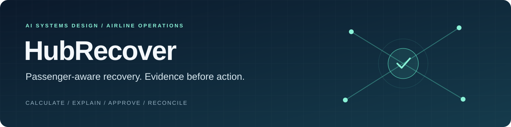
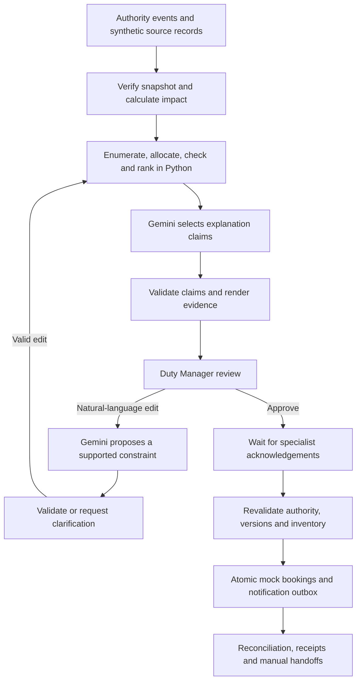

<div align="center">



**An AI systems design case study by Saurabh Bhardwaj**

Python · Google ADK · Gemini · FastAPI · SQLite

[The opportunity](#the-opportunity) · [System design](#how-the-system-thinks-and-who-can-act) · [Evidence](#evidence-over-impressions) · [Run the demo](#run-it-locally)

</div>

> **A weather disruption becomes a decision problem.** HubRecover helps an Operations Control Center Duty Manager compare feasible recovery options, understand passenger consequences, and approve a plan before any simulated rebooking or notification.

| Product scope | Engineering evidence | Live AI evidence |
| :--- | :--- | :--- |
| One fictional hub · 24 flights · 300 affected passengers in 150 parties | **157 passing regression tests** · completed local HTTP recovery workflow | **3/3 latest Gemini smoke checks passed** · repeated acceptance remains open |

This is a runnable **synthetic capstone**, with simulated roles, bookings and messages. Results describe the local prototype; they do not establish airline deployment readiness.

## The opportunity

### Bring passenger consequences into the recovery decision

A recovery plan can be operationally feasible and still leave passengers with missed connections, overnight arrivals or unresolved journeys. The design question behind HubRecover is:

**How can a Duty Manager compare aircraft, crew, dispatch and passenger trade-offs together—and retain control when the evidence changes?**

The discovery work in the [PRD](PRD.md#discovery) maps the target workflow, identifies decision owners, and turns suspected failure points into testable product requirements. Its working hypothesis is that reconciling information across specialist views can delay comparison and leave passenger consequences visible too late.

These are **discovery hypotheses**, not findings from completed airline interviews. Existing tool coverage, workflow timing and the target airline's responsibilities still need validation. The opportunity is a coordinated decision workflow within an OCC's existing processes.

| Discovery hypothesis | Product response | What would validate it |
| :--- | :--- | :--- |
| Passenger impact may be assessed too late to shape the recovery choice. | Show passenger outcomes alongside operational feasibility before approval. | Observe when passenger analysis happens in real recovery episodes. |
| Reconciling specialist information may create repeated checks and correction work. | Present a versioned source snapshot, comparable options and explicit prerequisites. | Measure missed facts, corrections and active staff effort against the current workflow. |
| A plan can become stale while people review it. | Bind approval to the current plan and source versions; revalidate before execution. | Review source-change cases with Duty Managers and controllers. |
| Partial execution and failed communication can leave ownership unclear. | Preserve receipts, separate booking from notification retries, and assign manual work. | Ask passenger-operations reviewers to trace unresolved cases to an owner. |

### The AI solution hypothesis

If the system calculates feasible options from verified data, and a bounded LLM helps the manager understand trade-offs and express supported edits, the manager may make a better-informed decision with less interpretation and correction effort.

The hypothesis has two parts to test separately: **does the recovery workflow help, and does AI add value beyond the rules-only version?** A matched manual / rules-only / AI-assisted comparison is planned. No time-saving, airline cost-saving or user-satisfaction result is claimed yet.

## A recovery episode you can follow

The reference scenario contains **18 day-one flights, six next-day alternatives and 300 affected passengers**. It creates real trade-offs within the fictional dataset: a shorter aircraft delay need not produce the best passenger outcome.

| Moment | What the user sees | What the system must prove |
| :--- | :--- | :--- |
| **1 · Recognise** | An applicable weather restriction and its downline impact | The event history meets the configured trigger; required facts are known. |
| **2 · Compare** | Ranked options, passenger counts, warnings and rejected evidence | Every selectable option passes the configured operational rules. |
| **3 · Refine** | “Protect the international connection” | The edit maps to a supported constraint and generates a fresh review card. |
| **4 · Authorise** | Duty Manager approval and specialist acknowledgements | Approval matches the current plan; operational prerequisites are satisfied. |
| **5 · Reconcile** | Party receipts, message outcomes and owned handoffs | Each recorded outcome is supported by a committed action. |

Try the ambiguity case too: **“Protect that one.”** The live AI check expects clarification, preserving the existing generation and expiry. Guessing the user's intended target would fail the check.

## How the system thinks—and who can act



### A small AI surface, with explicit contracts

Only **two components are LLM agents**: explanation and edit interpretation. Google ADK coordinates the workflow; pure Python owns calculations and policy checks; SQLite persists business authority separately from ADK sessions.

| Responsibility | Owner | Design decision |
| :--- | :--- | :--- |
| Feasibility, passenger allocation and ranking | Deterministic domain engine | Calculations must be reproducible and independently checkable. |
| Explaining options | Gemini + claim validator | The model selects supplied fact IDs, permitted reasons and eligible precedents. Code validates them before rendering. |
| Interpreting an edit | Gemini + constraint validator | A proposal must match a supported operation and an explicit target; ambiguity requires clarification. |
| Selecting a plan | Duty Manager | A generated recommendation cannot grant execution authority. |
| Confirming operational prerequisites | Simulated specialist roles | Approval alone does not prove a required operational change occurred. |
| Booking and communication | Guarded application services | The model has no operational tools. Every write requires current authority. |

Versioned fictional playbooks are filtered by scope, dates, strategy and approval status. The corpus is small enough for explicit filtering; a vector database would add complexity without an established need.

### Reliability is part of the product

- **Approval has a lifetime.** Cards and commands carry generation, source, policy, expiry and control bindings. Material changes cannot silently inherit an old approval.
- **A party moves atomically.** Seat accounting considers the net inventory change, preserves parties and keeps immutable superseded booking history.
- **A retry has a specific meaning.** Notification retries do not repeat bookings. Idempotency keys and worker fencing prevent duplicate or stale work.
- **A restart preserves responsibility.** Durable jobs and worker leases support recovery; invalid or expired authority produces a handoff.
- **An AI failure is visible.** Schema validation, verified token counting, persisted budgets and timeouts bound calls. Provider failures do not silently become sample AI output.

Explore the implementation: [domain engine](hubrecover/domain/) · [AI boundary](hubrecover/application/ai.py) · [execution service](hubrecover/application/service.py) · [durable jobs](hubrecover/application/jobs.py).

## Evidence over impressions

The evaluation framework combines **deterministic conformance, an independent calculation oracle, adversarial boundary tests, live-provider checks and planned human review**. Each layer answers a different question. A passing model response cannot compensate for an unauthorised write.

| Evaluation layer | Recorded result | What it establishes—and its limit |
| :--- | :--- | :--- |
| Regression and boundaries | **157/157 passed** | Implemented behaviour across allocation, approval, sources, restart and failure paths. [Verification record](evaluation/results/verification.json) |
| Development scenarios | **18/18 automatic diagnostics passed** | One implemented subvariant per family; not the full acceptance matrix. [Results](evaluation/results/development.json) |
| Deterministic conformance | **20/20 passed** | The suite was exposed during implementation, so it is not a blind quality holdout. [Results](evaluation/results/held-out.json) |
| Independent oracle | Reference feasibility, allocations and ranking agree; separate cap-selection checks cover 279 raw descriptors | Expected calculations live outside runtime model context. [Tests](tests/) |
| Actual local HTTP workflow | **150 party receipts · 300 sent mock messages** | The synthetic approval → acknowledgement → execution loop completed. [Report](evaluation/results/http-smoke.json) |
| Latest live Gemini smoke | **3/3 passed** on `gemini-3.8-flash` | Explanation, supported edit and ambiguous-edit clarification; one repeat each, no passenger effects. [Report](evaluation/results/live-ai-key-recheck.json) |
| Rules-only processing benchmark | **30/30 valid cards · p95 0.1523 seconds** | Local trigger-to-card processing, excluding model latency and human work. It is not a measured time saving. [Report](evaluation/results/benchmark.json) |

### What failed helped define the boundary

Live integration exposed ADK runner and structured-output compatibility issues, oversized edit context, and explanation predicates that needed a more explicit catalog. The implementation now bounds edit context to referenced IDs and validates the original strict schema after adapting it for transport.

Provider reliability also affected evaluation: an earlier repeated run passed **6/9** with quota errors; another passed **0/9** with unavailable responses and timeouts. The evaluator now spaces requests and stops on quota exhaustion. The latest updated-key smoke passed **3/3**. That recovery is recorded alongside the failures; it does not replace a successful repeated evaluation.

[Build history and limitations](BUILD-STATUS.md) · [Earlier quota report](evaluation/results/live-ai.json) · [Availability failure report](evaluation/results/live-ai-2026-10-19.json)

### The next evidence to collect

Human review will score clarity, evidence and passenger-trade-off comprehension, with reviewer expertise and disagreements recorded. The planned gate is at least 80% of reviewed cards scoring 4/5 or better on each dimension, with no missed critical warnings.

Matched scenarios will compare manual, rules-only and AI-assisted workflows for decision quality, task time, missed facts and corrections. The PRD's 50% median-time reduction is a **target to test**, not an achieved result. Human verdicts remain blank. Fresh independent holdout evaluation, repeated live-provider checks, rendered-browser QA and the broader PRD matrix remain open.

[Evaluation protocol](TEST-PLAN.md) · [Acceptance status](ACCEPTANCE.md)

## Run it locally

Requires **Python 3.11+** and **uv**.

```bash
git clone https://github.com/Bhardwaj-Saurabh/HubRecover_Airline_Disruption_Recovery_Assistant.git
cd HubRecover_Airline_Disruption_Recovery_Assistant
uv sync --locked
uv run python -m hubrecover
```

Open **http://127.0.0.1:8765**. On macOS, you can also double-click **Start HubRecover.command**. Keep the terminal open; press **Ctrl+C** to stop.

The complete rules-only demo works without a key. To enable Gemini, create a repository-local `.env` using [.env.example](.env.example) and set `GOOGLE_API_KEY` and `HUBRECOVER_GEMINI_MODEL`. The launcher loads these two settings automatically; existing process variables take precedence. `.env` is ignored by Git. Never commit credentials.

**Demo route:** select **Complete recovery** → inspect options → apply **Protect international connection** → approve → acknowledge each required specialist action → execute → inspect receipts and trace. Then try **Fail after 3 parties** or a material source change to see how the system preserves completed work and assigns the remainder.

```bash
# Regression tests
uv run pytest -q

# Three live AI checks; requires configured credentials
uv run python -m evaluation.live_ai --repeats 1

# Isolated local HTTP recovery workflow
uv run python -m evaluation.smoke
```

The default live evaluator runs up to nine requests with 15-second pauses. It records PASS, FAIL or NOT_RUN and never approves passenger actions. See the [runbook](RUNBOOK.md) for additional commands, persistence, restart behaviour and troubleshooting context.

## Explore the work

| If you want to assess… | Start here |
| :--- | :--- |
| Problem framing and product judgment | [Discovery and requirements](PRD.md) |
| AI architecture and authority boundaries | [Architecture design](ARCHITECTURE-ADK.md), then [implemented scope](BUILD-STATUS.md) |
| Evaluation rigor and honest reporting | [Test plan](TEST-PLAN.md) and [recorded results](evaluation/results/) |
| Recovery and transactional engineering | [Application services](hubrecover/application/) and [tests](tests/) |
| Interaction design | [Design specification](DESIGN.md) and [web interface](hubrecover/web/) |

**Scope:** one local process, one active episode per ledger, a bounded synthetic flight network and simulated roles. Live airline adapters, shared-user authentication, production deployment and the separate LMS browser ZIP are outside this deliverable.

---

<div align="center">

**Designed around a decision people can inspect, challenge and authorise.**

Product framing → bounded AI → deterministic validation → human control → measurable evidence

</div>
